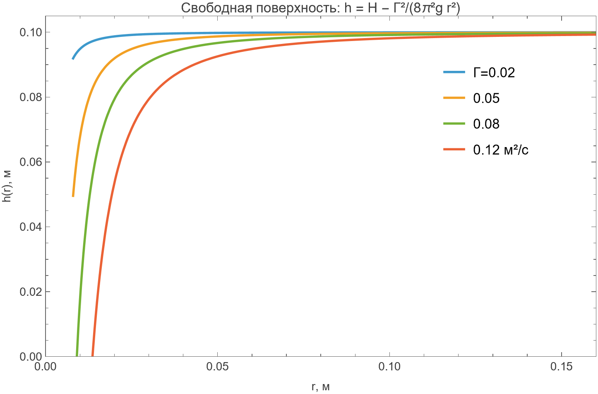
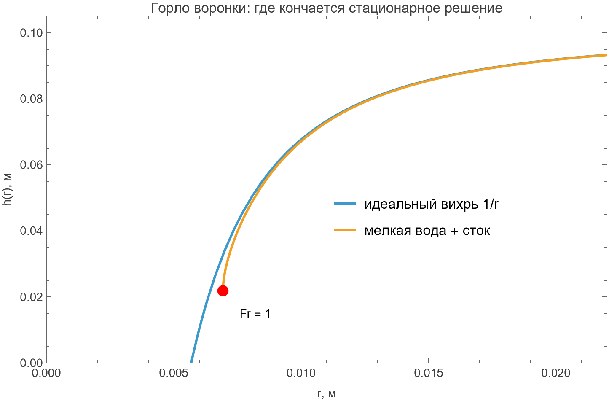
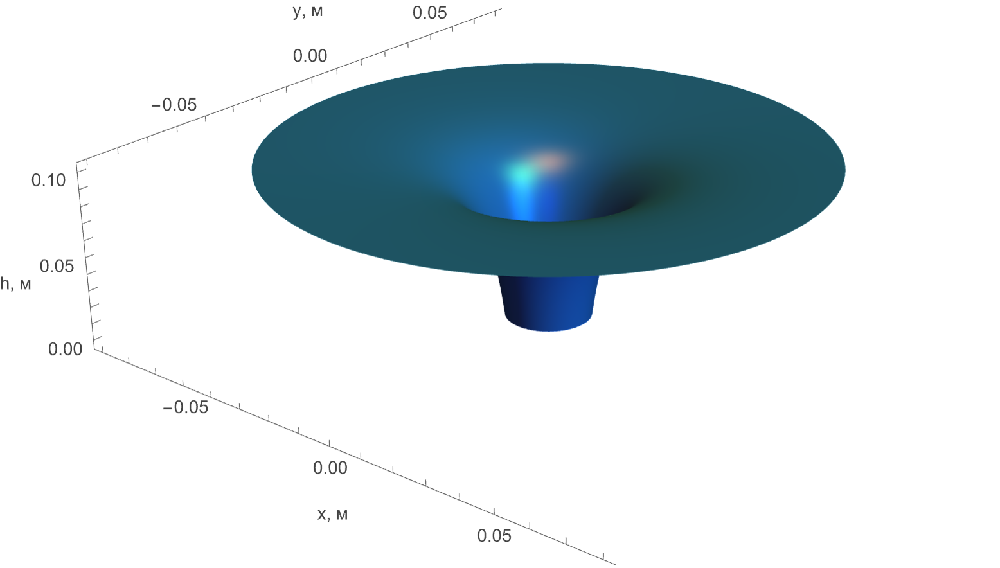

# Воронка в раковине: как математика описывает слив воды

Короткий ответ на вопрос «можно ли решить задачу математикой, или она слишком сложная»:
одной формулой — нет, но задача распадается на ярусы, каждый из которых решается
точно. Ниже — четыре модели возрастающей сложности и числа для обычной кухонной
раковины. Все выкладки проверены в Wolfram Language (Mathematica 15.0).

## 1. Постановка задачи

Рассматривается осесимметричный слив воды из сосуда с плоским дном. Модельная
геометрия и свойства воды:

| Величина | Обозначение | Значение |
|---|---|---|
| радиус слива | $a$ | 1 см |
| площадь слива | $A_d=\pi a^2$ | $3.14\cdot10^{-4}$ м² |
| площадь зеркала | $A$ | 0.1 м² |
| начальная глубина | $H$ | 0.10 м |
| плотность воды | $\rho$ | 1000 кг/м³ |
| кинематическая вязкость | $\nu$ | $10^{-6}$ м²/с |
| поверхностное натяжение | $\sigma$ | 0.072 Н/м |

Искомые величины: время полного слива $t$, форма свободной поверхности $h(r)$,
радиус воздушного ядра $r_c$. Допущения на каждом уровне оговариваются отдельно.

## 2. Сколько течёт: модель Торричелли

Скорость истечения из отверстия глубиной $h$:

$$
v=\sqrt{2gh},\qquad Q=A_d\sqrt{2gh}.
$$

Убыль уровня $dh/dt=-Q/A$ интегрируется:

$$
\int_H^{h}\frac{dh'}{\sqrt{h'}}=-\frac{A_d\sqrt{2g}}{A}\,t
\quad\Longrightarrow\quad
t=\frac{A}{A_d}\sqrt{\frac{2H}{g}}.
$$

Для модельной раковины $A_d=3.14\cdot10^{-4}$ м², откуда $Q=0.44$ л/с и

$$
t=45.4\ \text{с}.
$$

С коэффициентом расхода $C_d\approx0.62$ (острая кромка, сжатие струи)
$t=73.3$ с. Это нижняя оценка: воронка и сопротивление трубы только удлиняют слив.

## 3. Откуда воронка: сохранение момента импульса

Для идеальной жидкости при осевой симметрии момент импульса сохраняется:

$$
\Gamma=2\pi r v_\theta=\mathrm{const}
\qquad\Longrightarrow\qquad
v_\theta=\frac{\Gamma}{2\pi r}.
$$

В радиальном направлении жидкость вращается по окружности, поэтому нужен
центростремительный перепад давления:

$$
\frac{1}{\rho}\frac{dp}{dr}=\frac{v_\theta^2}{r}.
$$

На свободной поверхности $p=p_{\text{атм}}$, а гидростатика даёт $p=\rho g(h-z)$,
то есть $dp/dr=\rho g\,dh/dr$. Отсюда уравнение формы поверхности:

$$
\frac{dh}{dr}=\frac{v_\theta^2}{gr}=\frac{\Gamma^2}{4\pi^2 g r^3}.
$$

Интегрирование с условием $h\to H$ при $r\to\infty$ даёт замкнутую формулу воронки:

$$
\boxed{\;h(r)=H-\frac{\Gamma^2}{8\pi^2 g r^2}\;}
$$

Подстановка обратно в уравнение даёт тождественный нуль (в машинной арифметике
$4\cdot10^{-19}$ — см. раздел 6).

Свойства решения:

- просадка $\propto 1/r^2$ и $\propto\Gamma^2$: воронка широкая и пологая, с резким
  обрывом вблизи оси;
- поверхность касается дна (начинается воздушное ядро) при

$$
r_c=\frac{\Gamma}{2\pi\sqrt{2gH}};
$$

- для $\Gamma=0.05$ м²/с $r_c=5.7$ мм, для $\Gamma=0.10$ — 11.4 мм; на расстоянии
  2 см от оси поверхность проседает на 8.1 мм при $\Gamma=0.05$.

Оценка циркуляции: в раковине $v_\theta\approx0.3\div0.5$ м/с на $r=2$ см, что
соответствует $\Gamma=2\pi r v_\theta\approx0.04\div0.06$ м²/с. Значение $\Gamma=0.10$
отвечает энергичному размешиванию.

## 4. Учёт стока: кубика и критическое горло

Радиальное течение к сливу задаётся уравнением неразрывности:

$$
v_r=-\frac{Q}{2\pi r h}.
$$

Уравнение Бернулли вдоль свободной поверхности ($p=0$, $z=h$):

$$
gh+\frac{v_r^2}{2}+\frac{v_\theta^2}{2}=gH
\quad\Longrightarrow\quad
gh+\frac{Q^2}{8\pi^2r^2h^2}+\frac{\Gamma^2}{8\pi^2r^2}=gH.
$$

Это кубическое уравнение по $h$:

$$
g h^3-\left(gH-\frac{\Gamma^2}{8\pi^2r^2}\right)h^2+\frac{Q^2}{8\pi^2r^2}=0.
$$

Физическая (докритическая) ветвь существует, пока дискриминант положителен;
он обращается в нуль там, где число Фруда равно единице:

$$
\mathrm{Fr}^2=\frac{v_r^2}{gh}=\frac{Q^2}{4\pi^2 r^2 h^3 g}=1.
$$

В этой точке поверхность обрывается: ниже неё стационарного решения нет, вода
срывается в слив, и модель мелкой воды перестаёт работать. Это «горло» воронки.

Для $\Gamma=0$ решение выписывается аналитически:

$$
h=\frac{2H}{3},\qquad
r=\frac{Q}{2\pi}\sqrt{\frac{27}{8gH^3}}=1.299\ \text{мм},
$$

что совпало с численным решением системы (см. раздел 6). Для $\Gamma=0.05$ м²/с:

$$
h=2.18\ \text{см},\qquad r=6.93\ \text{мм}.
$$

Закрутка выносит горло наружу и вниз: воронка становится шире и глубже.

## 5. Вязкость: точное решение с регулярным ядром

Модель $v_\theta\propto1/r$ даёт бесконечную скорость на оси. Вязкость это лечит:
вихрь Бюргерса (Burgers, 1948) — точное решение стационарных уравнений
Навье–Стокса:

$$
v_\theta=\frac{\Gamma}{2\pi r}\left(1-e^{-ar^2/2\nu}\right),
\qquad v_r=-ar,\qquad v_z=2az,
$$

где $a$ — скорость радиального растяжения. Подстановка в $\theta$-компоненту
уравнений Навье–Стокса

$$
\nu\left(v_\theta''+\frac{v_\theta'}{r}-\frac{v_\theta}{r^2}\right)
-ar\,v_\theta'-a\,v_\theta=0
$$

даёт тождественный нуль (раздел 6) — это не приближение, а точное решение.

Структура: внутри ядра радиуса

$$
r_{\text{ядро}}=\sqrt{\frac{2\nu}{a}}
$$

жидкость вращается как твёрдое тело ($v_\theta\propto r$), снаружи — как
$1/r$. При $a=1$ с⁻¹ радиус ядра 1.41 мм — именно на этом масштабе воронка
становится воздушным ядром с захватом воздуха.

## 6. Проверки

| Утверждение | Способ проверки | Результат |
|---|---|---|
| $h=H-\Gamma^2/(8\pi^2gr^2)$ решает $dh/dr=v_\theta^2/(gr)$ | `FullSimplify` остатка | $4\cdot10^{-19}$ (машинный нуль) |
| Вихрь Бюргерса решает уравнения НС | `FullSimplify` остатка | ровно $0$ |
| Горло при $\Gamma=0$: $h=2H/3$, $r=1.30$ мм | аналитика vs `NSolve` | совпадение |
| Время слива $t=(A/A_d)\sqrt{2H/g}$ | предельные случаи, размерность | 45.4 с |
| Корни кубики при $r\le r_{\text{горло}}$ | `NSolve` | действительных ветвей нет |

## 7. Сводка численных результатов

| Величина | Формула / источник | Значение |
|---|---|---|
| Расход при полном уровне | $A_d\sqrt{2gH}$ | 0.44 л/с |
| Время слива (идеальное) | $(A/A_d)\sqrt{2H/g}$ | 45.4 с |
| Время слива ($C_d=0.62$) | $t_{\text{ид}}/C_d$ | 73.3 с |
| Радиус воздушного ядра, $\Gamma=0.05$ | $\Gamma/(2\pi\sqrt{2gH})$ | 5.7 мм |
| Радиус воздушного ядра, $\Gamma=0.10$ | то же | 11.4 мм |
| Просадка на $r=2$ см, $\Gamma=0.05$ | $\Gamma^2/(8\pi^2gr^2)$ | 8.1 мм |
| Горло, $\Gamma=0$ | $h=2H/3$ | 1.30 мм, 6.67 см |
| Горло, $\Gamma=0.05$ | `NSolve` | 6.93 мм, 2.18 см |
| Радиус вязкого ядра, $a=1$ с⁻¹ | $\sqrt{2\nu/a}$ | 1.41 мм |
| Число Рейнольдса | $vL/\nu$, $v=0.4$, $L=2$ см | $8\cdot10^3$ |
| Число Россби | $U/(\Omega L)$ | $1.4\cdot10^5$ |
| Экмановское время подкачки | $H/\sqrt{\Omega\nu}$ | 3.25 ч |
| Число Бонда (1 см / 1 мм) | $\rho gL^2/\sigma$ | 13.6 / 0.14 |

## 8. Границы применимости

Полностью задача не решается аналитически, и причина не в лени:

1. **Циркуляция $\Gamma$ — свободный параметр.** Он не выводится из геометрии:
   это память о том, как наливали и размешивали. Все формулы выше дают ответ
   «при данном $\Gamma$», а значение $\Gamma$ задаёт история.
2. **Течение нестационарно.** Уровень падает, $Q$ уменьшается, воронка перестраивается.
3. **Течение турбулентно** ($Re\approx8\cdot10^3$): ламинарные профили дают
   качественно верную структуру, но не точные пульсации.
4. **Поверхность рвётся.** Захват воздуха, пена, брызги, капиллярные волны на
   гребне; при $Bo\approx0.14$ на масштабе 1 мм поверхностное натяжение уже
   сравнимо с гравитацией и округляет «кончик» воронки.
5. **Срыв вихря** (vortex breakdown) над сливом — открытая задача гидродинамики
   в общем виде.
6. Полная постановка — трёхмерные нестационарные уравнения Навье–Стокса со
   свободной поверхностью и двухфазной средой, то есть DNS, а не формула.

## 9. Миф о силе Кориолиса

Направление закрутки в раковине часто объясняют вращением Земли. Оценка это
опровергает: время экмановской подкачки

$$
t_E=\frac{H}{\sqrt{\Omega\nu}}\approx3.25\ \text{ч}
$$

при $\Omega=7.29\cdot10^{-5}$ с⁻¹ и $H=10$ см. Это на два с половиной порядка
больше времени слива (45 с), а число Россби $Ro\sim10^5\gg1$: вращение Земли
для раковины пренебрежимо. Направление закрутки определяется остаточным
движением от налива и геометрией слива.

## 10. Выводы

1. «Слишком сложная» — верно только для полной постановки. Наблюдаемые величины
   (время слива, форма воронки, размер ядра) описываются формулами из одной-двух
   строк каждая.
2. Воронка — прямое следствие сохранения момента импульса: $h\propto1/r^2$.
   Она есть практически всегда, вопрос лишь в масштабе просадки.
3. Учёт стока добавляет кубику и критическое горло ($\mathrm{Fr}=1$), где
   воронка обрывается. При $\Gamma=0$ горло ровно на $2H/3$ — красивое
   аналитическое совпадение с численным решением.
4. Вязкость регуляризует ось: точное решение Бюргерса даёт ядро $\sim$мм —
   там и образуется воздушный столб.
5. Практический вывод: чтобы слив шёл быстрее, не нужно бороться с воронкой —
   она следует из гидродинамики; на время слива влияют $A_d$, $C_d$ и сопротивление
   трубы, а не закрутка.

## Литература

1. Burgers J. M. A mathematical model illustrating the theory of turbulence.
   *Advances in Applied Mechanics*, 1948.
2. Batchelor G. K. *An Introduction to Fluid Dynamics*. Cambridge University Press, 1967.
3. Bohr T., Dimon P., Putkaradze V. Shallow-water approach to the circular
   hydraulic jump. *J. Fluid Mech.*, 1993.
4. Ландау Л. Д., Лифшиц Е. М. *Гидродинамика*. М.: Наука, 1986.
