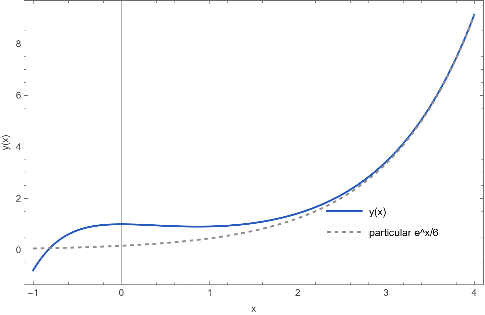
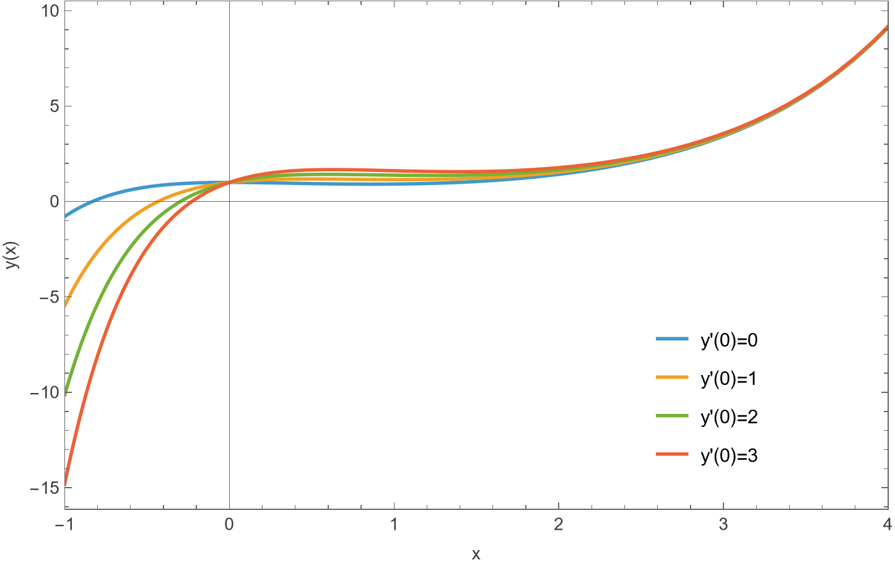

# Линейное ОДУ второго порядка с постоянными коэффициентами

Решение задачи Коши для уравнения $y'' + p\,y' + q\,y = f(x)$: общая формула
(произвольные $p$, $q$, $f$) и разобранный пример с конкретными коэффициентами
и начальными условиями. Расчёты выполнены в Wolfram Mathematica 15.0
(`DSolve`/`DSolveValue`), решение проверено независимой подстановкой.

## Постановка задачи

Требуется решить линейное неоднородное уравнение второго порядка

$$
y''(x) + p\,y'(x) + q\,y(x) = f(x), \qquad p, q \in \mathbb{R},\ f(x)\ \text{— заданная функция},
$$

и, где заданы начальные условия, — задачу Коши $y(0)=y_0$, $y'(0)=v_0$.

Конкретное уравнение в постановке не задано, поэтому рассмотрены два уровня:

1. общее решение с произвольными коэффициентами и произвольной правой частью;
2. пример $y''+3y'+2y=e^{x}$ с $y(0)=1$, $y'(0)=0$.

## Решение

### Однородное уравнение

Характеристическое уравнение $r^2 + p\,r + q = 0$ и его корни:

$$
r_{1,2} = \frac{-p \mp \sqrt{p^2-4q}}{2}, \qquad
y_h(x) = C_1 e^{r_1 x} + C_2 e^{r_2 x}\quad (r_1 \neq r_2).
$$

При $p^2 = 4q$ (кратный корень $r=-p/2$) фундаментальная система —
$e^{rx},\ x\,e^{rx}$, и решение имеет вид $y_h = (C_1 + C_2 x)\,e^{rx}$.

### Неоднородное уравнение: общее решение

Общее решение есть $y = y_h + y_p$, где частное решение даётся вариацией постоянных.
Для $p^2 \neq 4q$ Mathematica приводит его к виду (проверено подстановкой, см. ниже):

$$
y(x) = C_1 e^{r_1 x} + C_2 e^{r_2 x}
+ \frac{1}{\sqrt{p^2-4q}}\left[
e^{r_2 x}\!\!\int e^{-r_2 t} f(t)\,dt
- e^{r_1 x}\!\!\int e^{-r_1 t} f(t)\,dt
\right].
$$

Два начальных условия $y(0)=y_0$, $y'(0)=v_0$ дают линейную систему для $C_1, C_2$:

$$
C_1 + C_2 + y_p(0) = y_0, \qquad r_1 C_1 + r_2 C_2 + y_p'(0) = v_0 .
$$

### Пример: $y''+3y'+2y = e^{x}$, $y(0)=1$, $y'(0)=0$

Корни характеристического уравнения $r^2+3r+2=0$: $r_1=-1$, $r_2=-2$, поэтому
$y_h = C_1 e^{-x} + C_2 e^{-2x}$. Частное решение ищем в виде $y_p = A e^{x}$,
тогда $(1+3+2)A = 6A = 1$, то есть $y_p = e^{x}/6$. Общее решение:

$$
y(x) = \frac{e^{x}}{6} + C_1 e^{-x} + C_2 e^{-2x}.
$$

Из условий $y(0)=1$ и $y'(0)=0$:

$$
\frac{1}{6} + C_1 + C_2 = 1, \qquad \frac{1}{6} - C_1 - 2C_2 = 0
\;\Longrightarrow\;
C_2 = -\frac{2}{3},\quad C_1 = \frac{3}{2}.
$$

| Величина | Значение |
|----------|----------|
| Корни характеристического уравнения | $r_1=-1$, $r_2=-2$ |
| Частное решение | $y_p = e^{x}/6$ |
| Постоянные | $C_1 = 3/2$, $C_2 = -2/3$ |
| Решение задачи Коши | $y(x) = \dfrac{e^{x}}{6} + \dfrac{3}{2}e^{-x} - \dfrac{2}{3}e^{-2x}$ |

## Результаты

Итоговое решение задачи Коши:

$$
\boxed{\;y(x) = \frac{e^{x}}{6} + \frac{3}{2}e^{-x} - \frac{2}{3}e^{-2x}\;}
$$

Проверки:

- невязка при подстановке в уравнение на $x\in[-1,4]$ — не более $7.1\cdot10^{-15}$
  (численная проверка 9 точек, `wolfram_verify`);
- символьная проверка общей формулы: подстановка в $y''+p y'+q y-f(x)$ после
  применения правила Ньютона–Лейбница даёт тождественный $0$;
- $y(0)=1$ и $y'(0)=0$ выполняются точно; при $x\to+\infty$ решение ведёт себя как
  $e^{x}/6$, а на отрезке $[0,3]$ максимум $y(3)\approx 3.4206$.

На левом рисунке видно, что после затухания однородной части ($e^{-x}$, $e^{-2x}$)
кривая сливается с частным решением $e^{x}/6$. На правом — все решения с $y(0)=1$
при $s=y'(0)=0,1,2,3$ выходят на ту же асимптотику: начальная скорость влияет
только на переходный процесс вблизи $x=0$.

## Выводы

- Для ОДУ с постоянными коэффициентами решение сводится к двум шагам: корни
  характеристического уравнения и частное решение для $f(x)$; при кратных корнях
  ($p^2=4q$) нужен дополнительный множитель $x$.
- Общая формула через интегралы применима для произвольной непрерывной $f$; в примере
  с $f=e^{x}$ частное решение найдено подбором и совпало с формулой.
- Ограничения: коэффициенты постоянны; случай $p^2=4q$ и разрывные/кусочно-заданные
  $f$ (нужны условия сшивки) здесь не разбирались.

<!-- При наличии конкретного уравнения — подставить его коэффициенты и условия
     и пересчитать: заменяются только p, q, f(x) и начальные данные. -->
